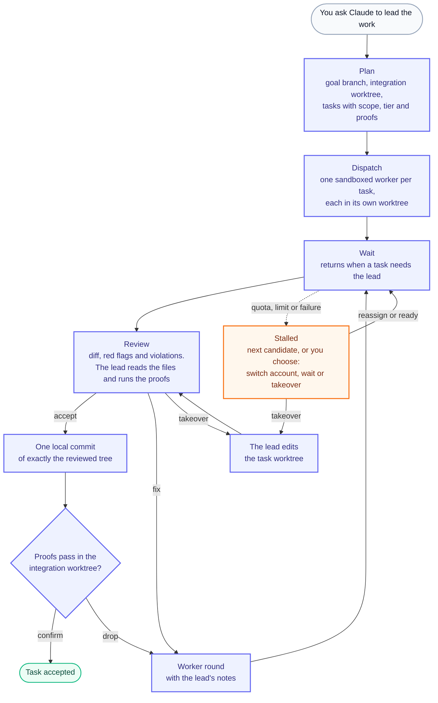

<h1 align="center">mandor</h1>

<p align="center"><strong>The foreman for your coding agents.</strong></p>

<p align="center">A Claude Code plugin that lets your session lead Codex, ZCode and Antigravity workers: it plans the goal, dispatches tasks to sandboxed workers, reviews every result, and lands each one as a guarded local commit. It never pushes.</p>

<p align="center">
  
  
  
  
  
  
  
  <a href="https://buymeacoffee.com/rmyndharis"></a>
</p>

> **Read [Before you start](#before-you-start) first.** mandor confines workers with `sandbox-exec`, so it runs on macOS only, and the Claude Code session that leads must have its own Bash sandbox turned off.

## TL;DR

```sh
git clone https://github.com/rmyndharis/mandor.git ~/mandor
~/mandor/bin/mandor init          # once: sets up ~/.mandor and reads the Codex model list
cd ~/your-project
claude --plugin-dir ~/mandor      # then ask Claude to lead the work
```

*Mandor* is Indonesian for foreman. The session you talk to is the foreman: it plans the goal, hands the coding to Codex, ZCode and Antigravity workers that run in parallel, each in its own git worktree under a kernel sandbox, reads what comes back, and accepts it as one local commit on a goal branch. You push when you are satisfied.

## The problem

Leading AI coding workers by hand comes down to three chores: keep each worker inside its task, read what it wrote before it reaches your branch, and pick the work back up when a quota runs out or you switch accounts. Skip one and a stray file, a deleted test or a leaked credential ends up in your history.

mandor turns the chores into a loop the lead follows, and enforces the parts that must not depend on anyone's attention. A worker's sandbox limits its writes to its own worktree. The lead cannot accept a result it has not reviewed, and the commit holds exactly the tree that review showed. Nothing is pushed. State lives on disk, so a quota wall or an account switch pauses the work instead of losing it.

## How it works

The Claude Code session you are in is the **lead**. It plans the goal and decides every outcome. **Workers** are Codex, ZCode or Antigravity CLI processes, one per task, each in its own git worktree under a kernel sandbox, writing code and running the proof commands the lead gave them. The **mandor** CLI sits between them: it keeps the state on disk, launches the workers, builds the review pack and enforces the guards. Independent tasks run in parallel, up to `maxParallel` workers per tool (two by default).



1. **Plan.** `goal start <branch>` creates the goal branch and an integration worktree for it. The lead splits the goal into tasks, each with scope globs, a tier and proof commands, and writes a brief for every task.
2. **Work.** `dispatch` makes a task worktree from the goal tip and starts a worker on it. The tier (`light`, `medium` or `heavy`) picks a model from its list of candidates, in order. `--use` pins one. `wait` returns when a task needs the lead.
3. **Review.** `review <slug>` prints the diff stat, the changed files, the red flags and the violations, and records the tree it showed. The lead reads every changed file and runs the proof commands itself. The worker's report is not evidence.
4. **Decide.** `accept` makes one local commit in the integration worktree. `fix` sends specific notes back to the same worker, for three rounds by default. `takeover` lets the lead make the change itself; after a stall it needs your approval.
5. **Confirm.** The lead reruns the proofs in the integration worktree. `confirm` closes the task. `drop` removes the commit and sends the notes back to the worker as a fix round.

When a worker hits a quota, a model limit or an account mismatch, the task moves to the next candidate for its tier. When every candidate is exhausted the lead asks you to choose: switch the worker account and run `mandor ready codex`, wait for the reset time that `mandor status` shows, or approve a takeover. A goal that moved while a task was in flight gets the change merged onto its new tip first, and the lead reviews again.

### Hooks

mandor registers two Claude Code hooks. Both do nothing outside a repository that already has a goal, with one exception below, and neither can break a session: a failure goes to `~/.mandor/logs/hooks.log` instead of reaching you. The exception is a Node the hooks cannot use. With no Node 22.18 or newer on the PATH the hooks run with, they do nothing and write nothing, as they cannot tell which directories have a goal. That PATH can differ from the one of Claude Code's Bash tool, for instance when an editor starts Claude Code. If you already have mandor state under `~/.mandor`, SessionStart then says in the session, in any directory, that the hooks are off.

- **SessionStart** prints a short summary of the goals, the tasks with their status, and any exhausted tool, so a new, resumed or compacted session can pick the work up. It also refreshes the Codex model list in the background.
- **Stop** blocks Claude from ending its turn, once, with a reminder to run `mandor wait` in the background, when this session has been leading, jobs are still running and no `wait` is watching them.

## Safety model

| Concern | What mandor does |
| --- | --- |
| A worker reaching beyond its task | Workers run under `sandbox-exec`, which limits their writes to their own worktree and the temporary directories. Each task carries scope globs, and the review flags files outside them. Denied paths make accept refuse: `.env` files other than their templates, keystores, signing properties, agent instruction files and `_docs/`. The commit message is held to the same list, except that it may name the secret files themselves, such as `.env` or a keystore. |
| Credentials | A worker's environment is an allowlist: no API keys, agent sockets or tokens, and a git and gh that cannot prompt or reach credentials. The network is closed unless the project allows it. Files your account can read are not hidden from a worker: see [Before you start](#before-you-start). |
| Unreviewed code | Accept commits only the tree the last `review` showed. An edit, a worker round, a rebase or a process left in the worktree changes that tree, and accept refuses until the lead reviews again. |
| A hostile repository config | A repository whose git config defines a filter or merge driver is refused, because such a command would run in the directory the worker writes to. A change under a relative `core.hooksPath` is refused too. The repository's other hooks still run at commit. |
| Traces of tooling in your history | The diff guards and the commit-message check refuse agent instruction files and directories (`CLAUDE.md`, `AGENTS.md`, `.claude/`, `.cursor/` and the like), symlinks that lead to denied paths, attribution to a tool or model (credits, author tags, trailers, the robot emoji), the dash glyphs U+2014, U+2013 and U+2015, and mandor's own forms of its name: the `.mandor` home path, the three `MANDOR_` variables, a command such as `mandor wait`, and the skill ids. The bare word *mandor* passes. Accept has no override. A repository about foremen says so once, with `--name-is-a-word` at `project setup`. |
| Pushing | mandor never pushes. It commits locally with the repository's own identity and refuses a placeholder identity (`example.com`, `localhost`, `.invalid`). |

**Violations** block accept. **Red flags** are for the lead to weigh: deleted or skipped tests, removed assertions, files outside the task's scope or on shared paths, added TODOs, commands the report claims but the worker never ran, generated inputs that went stale, and advisory attribution hints.

## Install

### Requirements

- **macOS.** Workers and every write to a worktree run under `sandbox-exec`, which exists only there.
- **Node 22.18 or newer.** The CLI is TypeScript run directly through Node's type stripping: no build step and no runtime dependency.
- **Codex CLI** (`codex`) on your `PATH`, logged in. Tested with 0.166.0; `mandor init` warns about any other version.
- **ZCode** (optional): the ZCode app in `/Applications`. Tested with its CLI 0.17.1. Its workers sign in on their own: see [ZCode workers](#zcode-workers).
- **Antigravity** (optional): the `agy` CLI on your `PATH`, signed in. Tested with 1.5.2. Read [Antigravity workers](#antigravity-workers) before you switch it on.
- **Claude Code** with plugin support. The plugin loads and its skills run on 2.1.319.

### Load the plugin

```sh
git clone https://github.com/rmyndharis/mandor.git ~/mandor
cd ~/your-project
claude --plugin-dir ~/mandor
```

Run `/mandor:status` to check it: outside a repository with a goal it prints that there is no project here, and the hooks stay silent.

This repository does not ship a marketplace listing yet, so `--plugin-dir` is how mandor is loaded today. The plugin puts `bin/` on the `PATH` of Claude Code's Bash tool, so Claude calls `mandor` directly. From a terminal, call `~/mandor/bin/mandor` or add that directory to your `PATH`.

## First use

1. **Set up the home.** `mandor init` creates `~/.mandor` and its `config.json`, reads the Codex model list, and prints warnings: an untested Codex version, secret-like variables exported by your login shell, a sandbox that cannot be applied, or a tier candidate the model list cannot run.
2. **Describe the repository (optional).** `mandor project setup`, run in the repository, records what workers need. Without it every list is empty and workers get no network. Each run states the whole configuration:
   - `--clone <path>`: an ignored path copied from the main checkout into each worktree (build caches, downloaded SDKs). Denied and agent paths inside it are skipped. The copy is an APFS clone, so `~/.mandor` (or `MANDOR_HOME`) must be on the same volume as the repository.
   - `--setup "<command>"`: run once in each new worktree, with the worker's environment variables but without a sandbox, so it can write and reach the network like any command you run yourself. Give it only a command you trust.
   - `--shared <path or glob>`: paths more than one task touches (a changelog, a lockfile). The review flags changes to them.
   - `--deny <glob>`: paths no task may change, on top of the defaults.
   - `--generator <clone path>=<glob>`: scripts whose change makes a cloned path stale.
   - `--worker-network`: lets workers reach the network. Off by default. A worker can read any file your account can read, so with the network on it can also send one out: see [Before you start](#before-you-start).
   - `--worker-add-dir <dir>`: a Gradle or Android cache directory workers may write.
   - `--name-is-a-word`: this repository's own subject uses the word *mandor*, a foreman. A phrase such as "the mandor status" in a file or a commit message is then no longer taken for the tool. A real invocation, a command with an option or through the launcher, is still refused.
3. **Ask for the work.** In Claude Code, describe the goal and ask Claude to lead it through mandor, for example *Use mandor to add pagination to the orders API, with tests*. You can also run `/mandor:lead <goal>`. Claude reports each event in one short line and asks you when the decision is yours, such as a takeover or an account switch.

## Commands

| Slash command | Effect |
| --- | --- |
| `/mandor:lead` | Load the lead's playbook: plan, dispatch, review, accept. Add the goal after the command, or just ask Claude to lead coding work through mandor and it loads the playbook itself |
| `/mandor:status` | Show the goals, tasks and exhausted tools of this repository |

The lead's commands print JSON; `status`, `show` and `logs` print plain text.

| You run | Purpose |
| --- | --- |
| `mandor init` | Create `~/.mandor`, read the Codex model list, print warnings |
| `mandor models [--refresh] [--json]` | List the models the enabled tools offer, with their efforts |
| `mandor login zcode [--api-key]` | Sign the ZCode worker in under a home of its own: in a browser, or with a Coding Plan API key piped in |
| `mandor project setup [flags]` | Record what workers need in this repository |
| `mandor status [--json]` | Goals, tasks, jobs, and the time each exhausted tool resets |
| `mandor show <slug>` | The outcome detail of a task, and each of its jobs with the tokens that run used |
| `mandor logs <slug>` | The paths of a task's job logs |
| `mandor --help` | List every command with its options |

| The lead runs | Purpose |
| --- | --- |
| `mandor scratch [name]` | Print the directory for briefs, plans and evidence files, which never go inside a repository |
| `mandor goal start <branch>` | Make the goal branch and its integration worktree. `--from <ref>` branches from another commit |
| `mandor plan set` | Record the plan: `--goal`, `--file` and `--description` |
| `mandor dispatch` | Start a worker on a task: `--goal`, `--task`, `--tier` and `--brief`, and optionally `--scope` (repeatable), `--use <tool:model@effort>` and `--after <slug>` |
| `mandor wait --since <cursor>` | Return when a task needs the lead. `--timeout <seconds>` bounds the wait |
| `mandor review <slug>` | Print the review pack and record the reviewed tree |
| `mandor verdict <slug> accept` | Commit the reviewed tree: `--evidence-file` and `--message-file` |
| `mandor verdict <slug> fix` | Send notes back to the worker: `--notes` |
| `mandor verdict <slug> takeover` | Make the change in the task worktree. `--approved` marks a takeover you approved after every candidate was exhausted or the fix rounds ran out |
| `mandor confirm <slug>` | Close a task after the proofs pass in the integration worktree: `--evidence-file` |
| `mandor drop <slug>` | Remove the commit and send the notes back: `--notes` |
| `mandor reassign <slug>` | Move a stalled task to its next candidate |
| `mandor ready <tool>` | After an account switch or a reset, resume the stalled tasks of that tool |
| `mandor cancel <slug>` | Stop a task's job and remove its worktree |

## Before you start

- **Turn off Claude Code's Bash sandbox for the session that leads.** `sandbox-exec` cannot run inside another sandbox, so `goal start` and `dispatch` refuse while the session's sandbox is on, and `init` warns. The workers stay confined by mandor's own sandbox.
- **Workers run on your Codex login.** They inherit your Codex instructions, rules, hooks, skills and plugins: `--ignore-user-config` skips only `config.toml`.
- **A worker can read what you can read.** Codex's `workspace-write` sandbox confines a worker's writes to its worktree and the temporary directories, not its reads, and the worker runs with your home directory. With the network closed, which is the default, what it reads can go nowhere but into its own worktree, where the review sees it, or into a temporary directory. With `--worker-network` it can send a file such as a key or a credential out, so turn that on only for a repository whose tasks you trust.
- **Workers have no network** unless you pass `--worker-network` to `project setup`. ZCode workers only run in a project that has it: see [ZCode workers](#zcode-workers).
- **Your repository gets branches and worktree registrations.** The goal branch, the `wip/` task branches and the worktree registrations stay until you remove them (see [State and uninstall](#state-and-uninstall)).

## Configuration

`mandor init` writes `~/.mandor/config.json` with defaults. A present file is the whole configuration: it is not merged with the defaults, and it must name all three tools. A minimal valid file looks like this; the defaults list more candidates per tier, `zcode` and `agy` ones included:

```json
{
  "version": 1,
  "tools": {
    "codex": { "enabled": true, "maxParallel": 2, "bin": "codex", "ignoreUserConfig": true },
    "zcode": { "enabled": false, "maxParallel": 2, "bin": "zcode", "ignoreUserConfig": true },
    "agy": { "enabled": false, "maxParallel": 2, "bin": "agy", "ignoreUserConfig": true }
  },
  "tiers": {
    "light": ["codex:gpt-6-luna@medium"],
    "medium": ["codex:gpt-6.1-sol@high", "codex:gpt-6-luna@high"],
    "heavy": ["codex:gpt-6.1-sol@max"]
  },
  "jobTimeoutMinutes": 60,
  "maxFixRounds": 3
}
```

Each tier lists its candidates as `tool:model@effort`, in order of preference; `mandor models` shows what Codex offers. A candidate the model list cannot run (a model your plan lacks, or one that was renamed) is passed over, and `mandor init` and `mandor models` warn about it. `maxParallel` caps the workers a tool runs at once, `jobTimeoutMinutes` ends a job that runs too long, and `maxFixRounds` is how many fix rounds a worker gets before the task needs a takeover. The Indonesian tier names `ringan`, `sedang` and `berat` are still read as `light`, `medium` and `heavy`, in `config.json` and for `--tier`.

| Variable | Effect |
| --- | --- |
| `MANDOR_HOME` | The state directory. Must be an absolute path. Defaults to `~/.mandor` |
| `MANDOR_CODEX_BIN` | The Codex binary. Overrides `tools.codex.bin` and the `PATH` lookup |
| `MANDOR_JOB` | Set by mandor in a worker's environment to the job id. You do not set it |

## ZCode workers

ZCode is off until you switch it on. Set `tools.zcode.enabled` to `true` in `~/.mandor/config.json`, then sign the worker in, one of two ways. With an API key: put `pbpaste | mandor login zcode --api-key` on your terminal's command line without running it, create a key for your Coding Plan at https://z.ai/manage-apikey/apikey-list and copy it, then press Enter. The order matters: the command reads the clipboard, so the key must be the last thing copied. The key never shows on screen or in your shell history, and it lasts until you revoke it. In a browser: run `mandor login zcode` and approve the sign-in, which stops working after an hour. `mandor models` then lists the models of your plan, and the `zcode:` candidates of each tier start to run.

A ZCode worker differs from a Codex worker in five ways:

- **A home of its own.** The worker runs with `~/.mandor/zcode/home` as its `HOME` and signs in there, so the sign-in of your ZCode app is never touched. The ZCode CLI reads your MCP servers, plugins, hooks, skills and instructions from `HOME`: a worker on your own home would load all of them into every turn.
- **mandor's own sandbox.** ZCode has no sandbox of its own, so the worker runs under a `sandbox-exec` profile: it writes only to its worktree, its own home and the temporary directories.
- **The network is always open.** The profile cannot close the network for the worker's commands and leave it open for the CLI that runs them. A ZCode job therefore refuses to start in a project without `--worker-network`. To make up for it, the profile keeps the worker from reading what your credential directories hold (`~/.ssh`, `~/.aws`, `~/.gnupg`, `~/.config/gh`, the homes of the other tools and the like) and the rest of `~/.mandor`. Any other file your account can read is still readable.
- **A browser sign-in runs out.** It lasts an hour and the CLI does not renew it. Every run then fails at once, so mandor sets the tool aside as it does one out of quota, and its tasks can move to another tool. Sign in again, then run `mandor ready zcode`. An API key does not run out. Either sign-in sits in the worker's home, which the worker's own commands can read: revoke the key at Z.ai if a run ever looks wrong.
- **The report is checked, not enforced.** ZCode has no output schema, so the prompt states the report's format and mandor takes the last JSON object of the answer. A run that ends on another model than the task asked for is failed: ZCode falls back to your plan's default model without saying so.

A bare `tools.zcode.bin` means the app's own executable in `/Applications`; give a path for an app kept elsewhere.

## Antigravity workers

Antigravity is off until you switch it on, and Google's terms are the reason to think first: its FAQ calls driving the `agy` CLI from another tool unsupported on consumer plans, and an account can be blocked for it. `mandor init` and `mandor models` repeat this while it is on. If you accept that, set `tools.agy.enabled` to `true` in `~/.mandor/config.json`. There is no separate sign-in: the worker runs on the account your Antigravity app holds, and `mandor models` lists what that account offers. A model's id carries its effort, so an `agy` candidate is written without one, as in `agy:gemini-4-argon-high`.

What mandor does for an Antigravity worker:

- **A configuration directory of its own.** The worker runs with `~/.mandor/agy/home` in place of `~/.gemini`, so your plugins, MCP servers, hooks and rules stay out of it. A hook of yours would otherwise rewrite the worker's commands.
- **Antigravity's own sandbox.** The worker's commands run in the CLI's sandbox: no write outside the worktree or into its git directory, and a network that reaches only what the sandbox's proxy lets through, whatever `--worker-network` says. A build that downloads its dependencies may fail there.
- **Narrow permissions.** Without a person to ask, the CLI refuses any tool that needs a permission and still reports success. Each run is given rules for exactly its worktree, the cache directories of `--worker-add-dir`, and commands. A run that was refused a tool is failed.
- **Paid credits are off.** Every run switches AI credits off for itself, whatever your settings say. Past the plan's quota the CLI would otherwise bill them, with no quota error.
- **A lost conversation starts over.** When the conversation of a fix round is gone, the CLI starts a new one without failing. mandor sees the new id and starts the task over once, from the work so far.

## State and uninstall

Everything lives under `~/.mandor`, or `MANDOR_HOME` when it is set: `config.json`, the model catalog, the ZCode worker's home with its sign-in, the Antigravity worker's configuration directory, one directory per project with its event ledger, tasks, rounds and scratch files, the task and integration worktrees, the job logs, and `logs/runner.log` and `logs/hooks.log`. A repository itself gets only the worktree registrations, the goal branch, the `wip/` task branches and the commits the lead accepted.

A job's directory, its logs included, is removed 30 days after the job ended, unless it is the newest job of a task that is still open.

To stop using mandor, stop passing `--plugin-dir`. To remove its state, delete `~/.mandor`, then in each repository run `git worktree prune` and delete the goal and `wip/` branches you no longer need.

## Known limits

- Three worker tools in this version: Codex, ZCode and Antigravity. Only Codex is on by default.
- You switch worker accounts yourself. mandor keeps the record of the work and resumes it with `mandor ready <tool>`.
- No dashboard: `mandor status`, the lead's reports in chat and the log files are the interface.
- A repository whose git directory is kept outside its work tree, made with `git init --separate-git-dir`, works from its main checkout. A linked worktree of it is a project of its own, because git does not say where the main checkout is.

## Development

mandor is TypeScript that Node runs directly, with no runtime dependencies.

| Path | Purpose |
| --- | --- |
| `.claude-plugin/plugin.json` | Plugin manifest |
| `hooks/hooks.json` | The SessionStart and Stop hooks |
| `skills/lead/SKILL.md` | The lead's playbook, loaded as `/mandor:lead` |
| `skills/status/SKILL.md` | `/mandor:status` |
| `bin/mandor` | The CLI launcher |
| `src/` | The CLI |
| `test/` | Tests, run with `node --test` |

```sh
npm install          # dev dependencies only, used by the type check
npm run typecheck
npm test
claude plugin validate .
```

Load your working copy into a session with `claude --plugin-dir .`.

## Contributing

Issues and pull requests are welcome. Keep changes small, add a test for any change in what a guard refuses or what a worker may do, and run `npm run typecheck` and `npm test` before you open a pull request.

A change that gives workers more reach than they have today (a wider environment, a writable path, a weaker guard) should explain in the pull request why it is safe.

## Support

If mandor saves you review time, you can support its development by buying me a coffee.

<a href="https://buymeacoffee.com/rmyndharis"></a>

## License

Released under the [MIT License](LICENSE).

Claude Code is a product of Anthropic and Codex is a product of OpenAI. mandor is an independent project and is not affiliated with or endorsed by Anthropic or OpenAI.

---

<p align="center">
  Made with ❤️ by <a href="https://github.com/rmyndharis">Yudhi Armyndharis</a> &amp; mandor contributors
</p>
